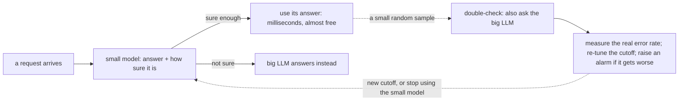
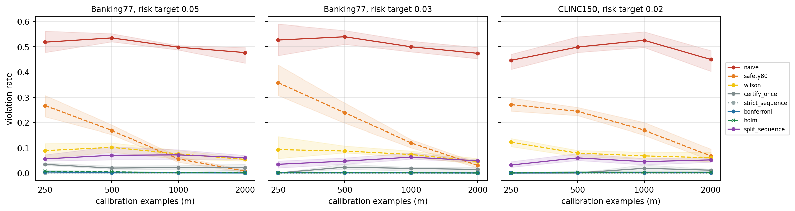
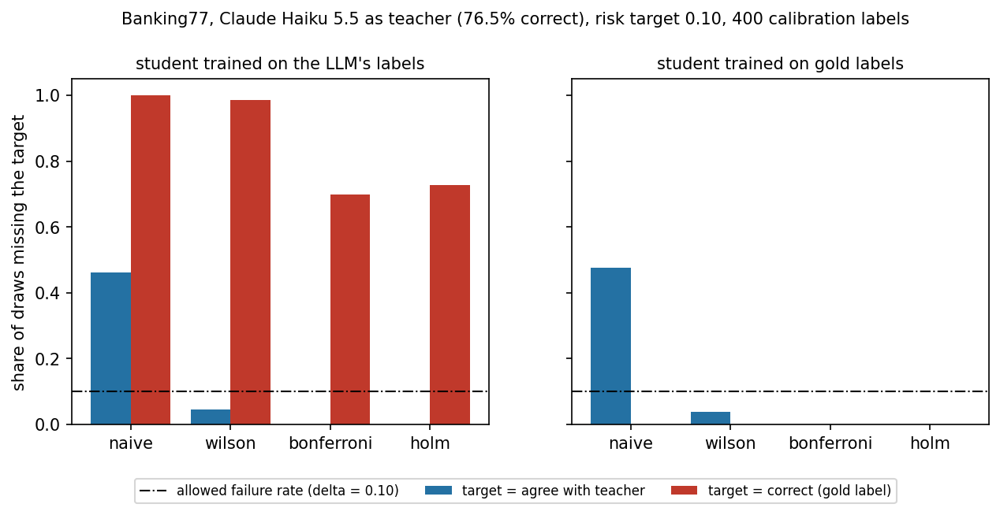
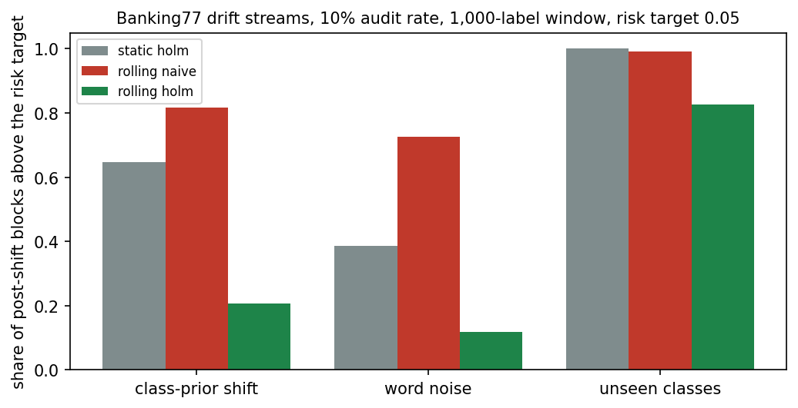
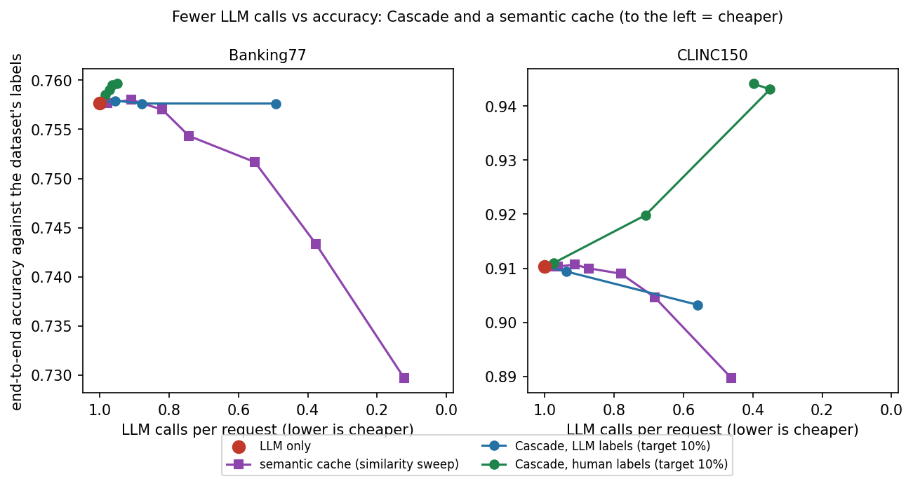
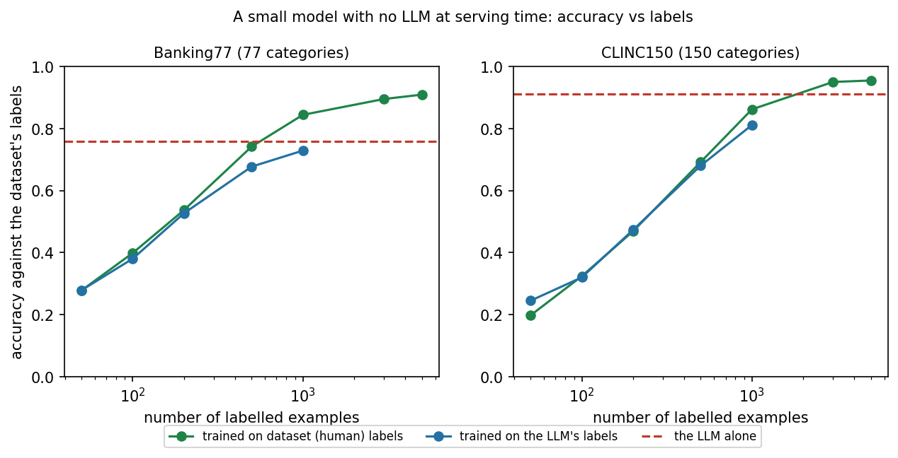
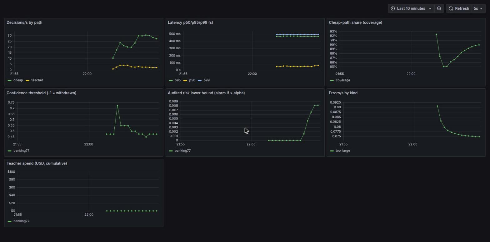

# Cascade

**Use a cheap, fast model for the easy requests and a powerful AI model (an LLM) only for the hard ones, and know, with statistics, how often the cheap model gets it wrong.**

   

**In one minute:** many apps send every request to an LLM (a ChatGPT-style model) even when most requests are simple. That is slow, costs money on every call, and makes you depend on someone else's service. Cascade sits in front of the LLM, answers the simple requests itself with a small model, and passes the rest on. The hard part, and the part Cascade is built around, is deciding **when the small model is trustworthy enough**, and proving it.

---

## The situation

Picture the support chat of a food-delivery app. Customers write things like *"my order is late"*, *"I want a refund"* or *"change my address"*. The app has to sort each message into a category (such as `late_order`, `refund`, `change_address`; AI people call these categories "intents") so it can send the message to the right team or trigger the right automation.

The quickest way to build this is to ask an LLM: *"Here is a customer message. Which of these categories fits it best?"* It works well and takes a day to set up.

> **Note what the AI is doing here.** It only picks a *category* for the message. It does not look up the refund or write the reply. After the message is sorted, your own code takes over as usual: it finds the customer's order in your database and sends the real refund status. Because the category ("this is a refund-status question") is the same for every customer, a small model can learn it. The per-customer details never pass through Cascade. A few months later it is handling thousands of messages a day and three things hurt:

- **Cost grows with every message.** Each one is a paid call to the LLM.
- **You depend on someone else's service** for speed and uptime: slow replies, rate limits, outages.
- **Most of that spend is wasted.** "Where is my refund?" is easy. You are paying the same price to answer it for the thousandth time as you paid the first.

## The idea

Messages repeat, so a small, cheap model can learn the easy cases by watching the LLM:

1. The big LLM answers a few thousand real messages. We call it the **teacher**.
2. A small, fast model learns from those answers. We call it the **student**. It runs on an ordinary CPU, in milliseconds, and costs almost nothing per call.
3. Each time a message arrives, the student gives its answer **and how sure it is** (its *confidence*). If it is sure enough, its answer is used. If not, the message goes to the teacher as before.

That saves most of the cost and delay, as long as the student is right when it says it is sure.

## The catch: "sure enough" is a judgement call

Someone has to pick the **cutoff**: the confidence level above which the student's answer is trusted. The natural way is to look at a sample of the student's answers and pick the cutoff that looks best on that sample. The trouble is that a cutoff chosen this way flatters itself: the sample that picked it is also the sample that "proves" it works. In our experiments on real datasets, a cutoff chosen this way **missed its own error target in roughly 40-60% of runs**, meaning the student made more mistakes than promised.

## What Cascade does

Cascade picks the cutoff using statistics, so that you get a real promise, for example: *"the student is wrong on at most 5% of the answers it handles, with 90% confidence"*. If the evidence is too thin to support a promise, Cascade **refuses to use the student** and everything keeps going to the LLM. Then it keeps checking after launch.



In short:
1. **Learn:** train the small model on the LLM's answers (a CPU is enough; no GPU needed).
2. **Certify:** pick the cutoff with a statistical guarantee, or decline to use the small model at all.
3. **Run and watch:** serve requests, double-check a small random share against the LLM, and re-tune or raise an alarm if the small model starts getting worse (for example because customers start asking new kinds of questions).

### Words used in this README

| Word | Meaning |
|---|---|
| **LLM** | A large AI model such as ChatGPT or Claude. Accurate, slow, and paid per call. |
| **Teacher** | The LLM, in its role as the one whose answers we want to match. |
| **Student** | The small, cheap model that learns from the teacher. |
| **Confidence** | How sure the student is about its own answer, from 0 to 1. |
| **Cutoff** | The confidence level above which the student's answer is used. |
| **Coverage** | The share of requests the student answers itself (the "cheap share"). |
| **Audit** | Randomly sending some already-answered requests to the teacher too, to measure the student's real error rate. |
| **Drift** | The real-world requests slowly changing, so the student gets worse over time. |

## Try it in 2 minutes (no API key, no dataset downloads)

This example simulates a small model whose mistakes we know exactly, and compares the two ways of picking the cutoff, many times over.

```bash
git clone https://github.com/pandey0/cascade && cd cascade
python3 -m venv .venv && . .venv/bin/activate
pip install -e .
python examples/quickstart.py
```

You will see:

```text
ONE AUDIT
  naive    : cutoff 0.60, 50% answered cheaply, real error rate 5.0%
  certified: cutoff 0.62, 47% answered cheaply, real error rate 4.7%

300 REPEATED AUDITS (target: error rate <= 5%)
  naive    : deployed 100% of the time, missed the target in 39% of those, 49% answered cheaply
  certified: deployed 86% of the time, missed the target in 0% of those, 27% answered cheaply
```

How to read it: *naive* is "pick the cutoff that looks best on the sample"; *certified* is Cascade's method. "Answered cheaply" is coverage; "real error rate" is how often the small model was actually wrong on what it answered. One audit can look fine either way. Repeat the audit 300 times and the difference shows: the naive cutoff misses the 5% target in about **4 runs out of 10**; the certified one essentially never does, at the price of answering **fewer requests cheaply** (27% vs 49% here) and sometimes declining to deploy. That trade, safety for savings, is the whole idea, and Cascade makes it explicit instead of hiding it.

## Run the service locally

Cascade also ships as a small web service (`POST /v1/decide`) with API keys, rate limiting, metrics and an audit log. The demo below uses a real small model and a **simulated** LLM, so it costs nothing:

```bash
pip install -e ".[gateway,bench]"            # bench pulls PyTorch + sentence-transformers (large; use the CPU wheel)
python scripts/exp1a_prepare.py banking77 0  # downloads a public customer-message dataset and prepares it (CPU, minutes)
./scripts/demo.sh                            # starts the service, sends real messages, prints a transcript
```

Output and a 41-second replay video: [docs/demo.md](docs/demo.md). The running service serves its API docs at `/docs`; a static copy is [docs/openapi.json](docs/openapi.json).

**Using it on your own data today** means five steps. Steps 2 and 3 are scripts you adapt, not yet a one-command tool:

1. Define your list of categories.
2. Label a few thousand real inputs with your LLM (`scripts/label_with_teacher.py`: dry run by default, hard spend cap, results cached; supports Claude and Gemini).
3. Train the small model and certify the cutoff on held-out, audited data (`scripts/build_demo_artifact.py` is a complete worked example).
4. Serve the saved result: `uvicorn --factory cascade.artifact:create_app_from_env` (configured by environment variables; see [docs/runbook.md](docs/runbook.md)).
5. Watch `/metrics` and the dashboard; the runbook says what to do when the alarm fires or the cutoff is withdrawn.

## What Cascade does today

| Part | Status |
|---|---|
| Choose the cutoff with a statistical guarantee (Python library) | **Built and tested.** Exact bounds (Clopper-Pearson, with Bonferroni or Holm correction) plus six other methods to compare against, including the naive one. |
| Train the small model and package it | **Worked example only** (`scripts/build_demo_artifact.py`, Banking77). Not yet a one-command tool. |
| Web service: decide, status, metrics | **Built and tested.** API keys with scopes, rate limiting and brute-force lockout, idempotency keys, backpressure, structured logs, Prometheus metrics, OpenAPI. |
| Double-checks, re-tuning, drift alarm | **Built.** Evaluated in simulations, and exercised on the live service only against a simulated LLM. |
| LLM adapters | **Claude: used for real** (it labelled the data for one experiment). **Gemini: unit-tested only, never called.** Both only answer with labels from your list, with cost accounting. |
| Docker image and Kubernetes (Helm) | **Built and tested locally** (single-node cluster). |
| AWS setup (Terraform) | **Validated only.** Never applied. |
| Dashboard and alert rules | **Built, and checked against a live local Prometheus and Grafana.** |
| **Not built** | A one-command training tool; rate limits shared across several replicas; distributed tracing; any production deployment. |

## How we tested it

"Tested" means two different things here, plus a note on what was real and what was simulated.

### A. Research experiments: does the statistical idea work?

These run on public customer-support datasets (Banking77: 77 categories; CLINC150: 150 categories) with a simple student (text embeddings plus logistic regression). No real customer traffic. Details and caveats: [docs/notes/](docs/notes/).

| Experiment | Question | Setup | Finding |
|---|---|---|---|
| **1a** | Does picking the cutoff naively break its promise on real data? | The dataset's labels stand in for the LLM; 5 data splits | Naive cutoffs missed the target in **43-58%** of draws; certified ones in **at most 0.5%**, at a cost of **4-12 points** of coverage with 1,000-2,000 audited examples. |
| **1b** | What changes when the LLM is real, and imperfect? | **Claude Haiku 5.5 labelled 2,000 messages per dataset** (about $0.9 in total); a student trained on its answers; compared against the dataset's labels | The LLM disagreed with the dataset's labels about 1 time in 4 on Banking77. The promise held *against the LLM*, but not against the truth: that student missed a correctness target in 70% of draws. A student trained directly on the dataset's labels beat the LLM (92% vs 76%). |
| **2** | What happens when requests change over time? | Constructed shifts on real data (different category mix, typos, unseen categories); 100 simulated streams per setting | On Banking77, re-checking against audited samples cut the share of stretches that broke the target from 39-65% to 2-33% for mild shifts. It did **not** recover from severe shifts (unseen categories) within 6,000 requests at a 10% audit rate. The drift alarm raised no false alarms but was slow. |
| **3** | Does Cascade beat the alternatives a sensible team would try first? | Same data; a small model trained on human labels, a small model trained on the LLM's labels, Cascade, and a semantic cache (reuse an earlier answer when a similar message was seen); accuracy against the dataset's labels; year-1 cost at 10,000 to 10 million requests/day | **With 500-3,000 human labels a small model alone beats the LLM** (Banking77: 84.4% with 1,000 labels vs the LLM's 75.8%; CLINC150: 95.0% with 3,000 vs 91.0%) and is cheapest from roughly 100,000 requests/day against an uncached LLM (about 0.6-0.8 million/day against a cached one). **With only LLM labels**, Cascade (10% target) halves LLM calls with under a point of accuracy lost; a semantic cache reaches a similar reduction with less machinery but no guarantee. Details: [docs/notes/comparison-findings.md](docs/notes/comparison-findings.md). |
| **Cost model** | When does the setup pay for itself? | A formula, the measured price per call ($0.0002 for the Claude run), and assumed hosting ($0.15/hour per node, 2 nodes) and engineering ($10,000) costs | Labelling alone pays back in about 5,000-12,500 requests, but **hosting and engineering dominate**: with an inexpensive LLM the savings only cover hosting at roughly **75,000 requests/day**, and repaying the engineering takes roughly **1 million/day**. A probe showed **prompt caching makes the LLM call 7.2 times cheaper** at our prompt size, which raises those thresholds several times over (about 550,000/day to cover hosting). [Details and assumptions](docs/critique.md). |

| | |
|---|---|
|  **Experiment 1a.** Naive cutoffs miss their target about half the time near the achievable error rate; certified cutoffs stay far below the allowed 10% of misses. |  **Experiment 1b.** Left: a student trained on the LLM's answers keeps missing a *correctness* target even when certified against the LLM. Right: a student trained on the dataset's labels does not. |
|  **Experiment 2.** Share of post-change stretches that break the target, for three ways of handling change. |  **Experiment 3.** Fewer LLM calls (to the left) against accuracy, for Cascade and a semantic cache. The vertical axis is zoomed: Banking77 differences are under 3 points. |
|  **Experiment 3.** A small model with no LLM at serving time: accuracy against the number of labelled examples, compared with the LLM alone (dashed). | |

### B. Software tests: does the code behave?

These test the web service and its packaging, using a **simulated LLM** so they cost nothing and are repeatable.

| Test | What it checks | Result |
|---|---|---|
| Automated tests | Statistics, decision logic, the API (auth, limits, idempotency), the audit database (migrations, backup and restore), the adapters (with fake clients) | **98 tests pass, 93% code coverage** |
| Continuous integration (GitHub) | Every push: lint, strict type checks, tests on Python 3.10 and 3.12, secret and dependency scans, container build and vulnerability scan, alert-rule and Terraform and Helm checks | **Green** (no high or critical vulnerabilities with a fix available) |
| Failure injection | LLM failing 30% of calls, down completely, slower than the timeout, and the service being stopped mid-load | While the LLM failed, slowed or was down, the cheap path kept answering and the service stayed healthy; when stopped mid-load it shut down in under a second ([docs/reliability.md](docs/reliability.md)) |
| Kubernetes | Install the Helm chart on a real local cluster, check auth and security settings, restart the pods under traffic | **553 of 553 requests succeeded** through a rolling restart ([infra/README.md](infra/README.md)) |
| Load test (Locust) | Throughput, latency, CPU and memory, with and without batching the encoder | Batching: median **58 vs 27 requests/s**, p99 latency 900 vs 1400 ms, 0 failures. Shared desktop, so treat as indicative ([docs/perf.md](docs/perf.md)) |
| Live monitoring | A running Prometheus and Grafana against the service | All 11 alert rules evaluate; all 7 dashboard panels show data |
| Security self-check | Mapped against the OWASP ASVS Level 1 list; gaps found were fixed | Details in [docs/security.md](docs/security.md) |


*The Grafana dashboard on a live local service: the cutoff is re-tuned from the audits while the cheap share dips and recovers.*

### What was real, and what was simulated

| Real | Simulated or not done |
|---|---|
| Public datasets, the text encoder, the small model, the statistics | **The LLM in every demo, load test, failure test and Kubernetes test** (a stand-in that answers after 300 ms) |
| Claude Haiku 5.5 labelling 4,000 messages for experiment 1b | Customer traffic: requests are replayed dataset messages |
| The web service, Docker image, GitHub CI and release | The changes in experiment 2 are constructed from real data, not observed in production |
| A local single-node Kubernetes cluster; local Prometheus and Grafana | **Any production deployment, the AWS setup, real users, long-running tests** |

## Is this for you?

**Good fit:** your app picks from a fixed list of choices (classify, tag, route, choose a tool); volume is high and repetitive; you would accept the LLM's answers as the reference; and the bill, delay or rate limits now matter.

**Not a good fit:**

| Situation | Better choice |
|---|---|
| Under roughly 100,000 requests a day with an inexpensive LLM (about 0.5-1 million with prompt caching) | Just call the LLM, **with prompt caching** (measured 7.2 times cheaper per call). Our own cost model says hosting and engineering outweigh the savings below that. |
| A few hundred requests a day, or a small bill | Just call the LLM. This is not worth the complexity. |
| You already have, or can cheaply get, 500-3,000 human-labelled examples | Train a small model on them directly. In our comparison it beat the LLM's accuracy on both datasets and was cheapest above roughly 100,000 requests/day ([findings](docs/notes/comparison-findings.md)). |
| Free text, reasoning, summaries | Keep the LLM. A small model on text embeddings will not work. |
| The answer must be written for each customer from their own data, or the right choice depends on data that is not in the message | Not supported today: the small model sees only the message text. Keep the LLM for those, or use Cascade just for the sorting step. |
| Categories change every week | Expect frequent re-training and refusals; consider retrieval instead of a fixed list. |
| High-stakes decisions (credit, hiring, safety) | Keep a human in the loop. A statistical bound on agreement is not enough justification. |
| You want something working this week | Try [TRACER](https://github.com/adrida/tracer), an open-source project built on the same core idea. |

## Honest limits

- **Does it really help? Only in a narrow regime.** Read the adversarial review first: [docs/critique.md](docs/critique.md). It covers the cost reality, two measured defects (audits add the LLM's latency to the audited requests; the LLM-call thread pool can be exhausted), state that is per replica, and the comparison we have not run (against a fine-tuned small model, prompt caching or a semantic cache).
- **Alpha software (v0.1.0).** Not deployed anywhere; the AWS setup has never been applied; the repo is private for now.
- **The promise is about agreement with the LLM, not about being correct.** If the LLM is wrong 1 time in 4, a student that copies it inherits that. Our experiments show this clearly ([docs/notes/exp1b-findings.md](docs/notes/exp1b-findings.md)).
- **It assumes the audited sample looks like today's requests.** When requests change, that breaks; the audits and the alarm exist to catch it, but recovery takes time (about `audited labels / audit rate` requests).
- **Small-scale evidence:** two public datasets, one simple student, one LLM, a few data splits; the demo and load tests use a simulated LLM on a shared desktop.

## Documentation

| Read | For |
|---|---|
| [docs/critique.md](docs/critique.md) | **An honest, adversarial review:** does this really help, from an architect's, AI engineer's and developer's view |
| [docs/story.md](docs/story.md) | A longer worked example and the reasoning behind this README |
| [docs/architecture.md](docs/architecture.md) | How the pieces fit together |
| [docs/runbook.md](docs/runbook.md), [docs/slo.md](docs/slo.md), [docs/reliability.md](docs/reliability.md) | Operating it |
| [docs/security.md](docs/security.md) | Threat model and an OWASP-based self-check |
| [docs/notes/](docs/notes/) | Experiment findings and the literature check |
| [docs/evidence.md](docs/evidence.md) | Figures, screenshots, demo video, logs |
| [SCORECARD.md](SCORECARD.md) | Production-readiness checklist, with evidence and gaps |
| [paper/](paper/) | Unpublished draft and the claim-to-evidence map |

## Where the ideas come from

Cascade builds on existing research and does not claim to have invented it. Letting a model say "I'm not sure" and choosing the cutoff with a statistical guarantee is called *selective classification*, with the threshold method going back to [Geifman and El-Yaniv (2017)](https://arxiv.org/abs/1705.08500) and a general framework in [Learn then Test](https://arxiv.org/abs/2110.01052). Using a small model trained on an LLM's own answers to take over its easy requests, with a quality check before it goes live, is the idea behind a recent open-source project and paper, [TRACER](https://arxiv.org/abs/2604.14531). What Cascade adds is a side-by-side comparison of ways to choose the cutoff, a study of what goes wrong when the LLM itself is imperfect or when requests change over time, and a tested web service around them. Full details: [docs/notes/literature-check.md](docs/notes/literature-check.md) and [docs/REFERENCES.md](docs/REFERENCES.md).

## Contributing and license

See [CONTRIBUTING.md](CONTRIBUTING.md) (`make check` runs lint, strict type checks and tests). Changelog: [CHANGELOG.md](CHANGELOG.md). Licensed under the [MIT License](LICENSE).
