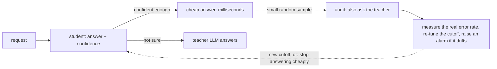

# Cascade

**Stop paying a big LLM to answer questions a tiny model can answer. Cascade answers the easy ones cheaply, sends only the hard ones to the LLM, and tells you, with statistics, how often the cheap answer is wrong.**

   

---

## The problem

You add an AI feature to your product: every incoming customer message goes to an LLM with the prompt *"which of these 77 intents is this?"* (`card_declined`, `refund_status`, `change_address`, ...). It works, and it ships in a day. Months later it handles thousands of messages a day, and three things hurt:

- **Cost grows with every message.** Each one pays for a long prompt plus an answer.
- **You depend on someone else's API** for speed and uptime: slow responses, rate limits, outages.
- **Most of that spend is wasted.** "Where is my refund?" is not hard, yet you pay the same price to answer it for the thousandth time.

The obvious fix is to train a small model on the LLM's answers and let it handle the easy cases. That part is easy. The part that bites is this one:

> **How confident does the small model have to be before you trust it?** Pick the cutoff by looking at a sample of its answers and "choosing the best-looking one", and the real error rate often ends up *worse than you intended*. In our experiments on real datasets this naive choice missed its own error target in roughly **40-60% of runs**.

## Where Cascade fits

You keep your LLM (we call it the **teacher**). Cascade puts a cheap **student** model in front of it and adds a safety net around the cutoff.



1. **Learn:** the student is trained on the teacher's answers (CPU is enough; no GPU).
2. **Certify the cutoff:** on a held-out, audited sample, Cascade picks the most generous cutoff whose error rate is provably below your target (for example "wrong at most 5% of the time, with 90% confidence"). If the evidence is not strong enough, it **refuses to answer cheaply** and everything keeps going to the LLM.
3. **Serve and keep checking:** confident requests are answered by the student; a small random share of them is also sent to the teacher so the real error rate keeps being measured. If it creeps up, Cascade re-tunes the cutoff or falls back to the LLM.

## Try it in 2 minutes (no API key, no dataset downloads)

```bash
git clone https://github.com/pandey0/cascade && cd cascade
python3 -m venv .venv && . .venv/bin/activate
pip install -e .
python examples/quickstart.py
```

You will see (numbers from a synthetic student where the true error rate is known):

```text
ONE AUDIT
  naive    : cutoff 0.60, 50% answered cheaply, real error rate 5.0%
  certified: cutoff 0.62, 47% answered cheaply, real error rate 4.7%

300 REPEATED AUDITS (target: error rate <= 5%)
  naive    : deployed 100% of the time, missed the target in 39% of those, 49% answered cheaply
  certified: deployed 86% of the time, missed the target in 0% of those, 27% answered cheaply
```

One audit can look fine either way. Repeat it 300 times and the difference shows: the naive cutoff misses the target about **4 times in 10**; the certified one essentially never does, at the price of answering **fewer requests cheaply** (27% vs 49% here) and sometimes declining to deploy. That trade (safety for savings) is the whole idea, and Cascade makes it explicit instead of hiding it.

## Run the service locally

The gateway is a small HTTP service (`POST /v1/decide`) with API keys, rate limiting, metrics and an audit log. The demo below uses a real small model and a **simulated** teacher, so it costs nothing:

```bash
pip install -e ".[gateway,bench]"            # bench pulls PyTorch + sentence-transformers (large; use the CPU wheel)
python scripts/exp1a_prepare.py banking77 0  # downloads the Banking77 dataset and embeds it (CPU, minutes)
./scripts/demo.sh                            # starts the gateway, sends real messages, prints a transcript
```

Output and a 41-second replay video: [docs/demo.md](docs/demo.md). API reference: the running service serves `/docs` (Swagger UI); a static copy is [docs/openapi.json](docs/openapi.json).

**Using it on your own decisions today** means five steps. Steps 2 and 3 are scripts you adapt, not yet a one-command CLI:

1. Define your closed set of labels.
2. Label a few thousand real inputs with your teacher (`scripts/label_with_teacher.py`: dry run by default, hard spend cap, cached; supports Claude and Gemini).
3. Train the student and certify the cutoff on held-out audited data (`scripts/build_demo_artifact.py` is a complete worked example).
4. Serve the saved artifact: `uvicorn --factory cascade.artifact:create_app_from_env` (settings via environment variables; see [docs/runbook.md](docs/runbook.md)).
5. Watch `/metrics` and the dashboard; the runbook says what to do when the drift alarm fires or the cutoff is withdrawn.

## What you get

| | |
|---|---|
| **Certified cutoff selection** | Exact statistical bounds (Clopper-Pearson with Bonferroni or Holm correction) plus six other methods to compare against, including the naive one. |
| **Gateway** | FastAPI service: API-key auth with scopes, rate limiting and brute-force lockout, idempotency keys, backpressure, structured logs, Prometheus metrics, OpenAPI. |
| **Audit and drift handling** | Uniform random audits, rolling re-certification, an anytime-valid drift alarm, fail-open or fail-closed behaviour when the teacher is down. |
| **Teachers** | Claude and Gemini adapters that return only labels from your closed set, with token and cost accounting. |
| **Operations** | Docker image, Helm chart (tested on a real cluster), Terraform for AWS (validated, never applied), Grafana dashboard, alert rules, runbook, SLOs. |
| **Reproducible research** | Every number in the docs comes from a script in `scripts/`, with run manifests and a ledger in `evidence/`. |

## Results at a glance

All on Banking77 / CLINC150 with a simple student (frozen sentence embeddings + logistic regression). Details and caveats are in [docs/notes/](docs/notes/).

| | |
|---|---|
|  **Naive cutoffs miss their target about half the time** near the achievable error rate; certified cutoffs keep misses far below the allowed 10%, giving up about 4-12 points of coverage. |  **A real LLM teacher is wrong too** (Claude Haiku 5.5 agreed with the dataset labels 76.5% of the time on Banking77). Agreeing with it is not the same as being correct. |
|  **Under drift**, re-certifying on audited samples helps for mild shifts and is not enough for severe ones (classes the student never saw). |  **The Grafana dashboard** on a live gateway: the cutoff is re-tuned from audits while the cheap-path share dips and recovers. |

Also measured: the cheap path stays up when the teacher fails or times out ([docs/reliability.md](docs/reliability.md)); a rolling restart on Kubernetes served 553/553 requests ([infra/README.md](infra/README.md)); micro-batching the encoder raised throughput in every paired local run ([docs/perf.md](docs/perf.md), noisy shared machine).

## Is this for you?

**Good fit:** a closed set of choices (classify, tag, route, pick a tool); high volume of repetitive inputs; an LLM whose answers you would accept as the reference; a bill, latency or rate limit that now matters.

**Not a good fit:**

| Situation | Better choice |
|---|---|
| Hundreds of decisions a day, or a small bill | Just call the LLM. This is not worth the complexity. |
| You already have thousands of human-labelled examples | Train a classifier on them directly: usually more accurate, no teacher cost. |
| Free text, reasoning, summaries | Keep the LLM. A small embedding-based student will not work. |
| Categories change every week | Expect frequent re-training and refusals; consider retrieval instead of closed labels. |
| High-stakes decisions (credit, hiring, safety) | Keep a human in the loop. A statistical bound on agreement is not enough justification. |
| You want something that works this week | Try [TRACER](https://github.com/adrida/tracer) (same core idea, on PyPI). |

## Honest limits

- **Alpha software (v0.1.0).** Not deployed anywhere; Terraform has never been applied; the repo is private for now.
- **The guarantee is about agreement with the teacher, not correctness.** If the teacher is wrong 24% of the time, a student that copies it inherits that. Our experiments show this clearly ([docs/notes/exp1b-findings.md](docs/notes/exp1b-findings.md)).
- **It assumes the audited sample looks like today's traffic.** Drift breaks that; the audits and the alarm exist to catch it, but recovery takes about `labels / audit_rate` decisions.
- **Small-scale evidence:** two public datasets, one simple student, one teacher model, a few splits; the demo and load tests use a simulated teacher on a shared desktop.

## Documentation

| Read | For |
|---|---|
| [docs/story.md](docs/story.md) | The longer worked example behind this README |
| [docs/architecture.md](docs/architecture.md) | How the pieces fit |
| [docs/runbook.md](docs/runbook.md), [docs/slo.md](docs/slo.md), [docs/reliability.md](docs/reliability.md) | Operating it |
| [docs/security.md](docs/security.md) | Threat model and an ASVS-based self-check |
| [docs/notes/](docs/notes/) | Experiment findings, the TRACER analysis, literature check |
| [docs/evidence.md](docs/evidence.md) | Figures, screenshots, demo video, logs |
| [SCORECARD.md](SCORECARD.md) | Production-readiness checklist with evidence and gaps |
| [paper/](paper/) | Unpublished draft and the claim-to-evidence map |

## How this relates to prior work

[TRACER](https://arxiv.org/abs/2604.14531) already combines a student trained on LLM answers with an agreement gate; certified threshold selection goes back to [Geifman and El-Yaniv (2017)](https://arxiv.org/abs/1705.08500) and [Learn-then-Test](https://arxiv.org/abs/2110.01052). Cascade does not claim to invent these. What it adds is an empirical comparison of selection methods in the LLM-distillation setting, a study of teacher noise and drift, and an engineered, tested gateway around them. See [docs/notes/literature-check.md](docs/notes/literature-check.md) and [docs/REFERENCES.md](docs/REFERENCES.md).

## Contributing and license

See [CONTRIBUTING.md](CONTRIBUTING.md) (`make check` runs lint, strict types and tests). Changelog: [CHANGELOG.md](CHANGELOG.md). Licensed under the [MIT License](LICENSE).
