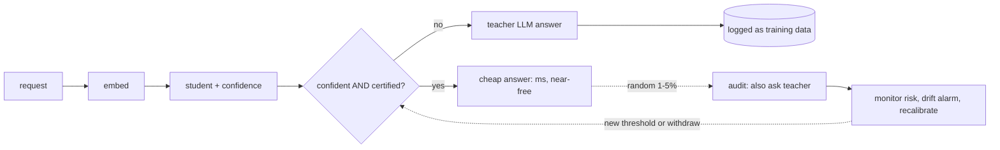

# cascade

Certified cost-quality decision cascades: answer a decision with a cheap model when it is confident, escalate to a teacher (usually an LLM) when it is not, and **bound how often the cheap path disagrees with the teacher**.

**Status: v0.1.0 (alpha).** Built and tested: exact binomial bounds; eight threshold-selection gates (naive, safety-factor, Wilson, certify-once, strict-sequence, Bonferroni, Holm, split-sequence); a decision engine with uniform audit sampling, rolling Holm recalibration and an anytime-valid drift alarm; a hardened FastAPI gateway (API-key auth, validation, rate limiting, idempotency keys, backpressure, Prometheus metrics, structured logs); a SQLite audit store (migrations, backup/restore, no raw text kept); Claude and Gemini teacher adapters with a spend-capped cache; micro-batching; a break-even economics model; real-data experiments on Banking77 and CLINC150 (gold teacher, a real LLM teacher, and drift streams). **Not done / not claimed:** no cloud deployment has been run (Terraform and Helm are written, not applied); CI has not run on GitHub yet; no comparison against TRACER's package; one student family (frozen embeddings + logistic regression); preliminary single-seed drift results. See `COMPLETION-PLAN.md`, `SCORECARD.md` and `paper/CLAIMS.md` for the claim-to-evidence map.

## Results so far (all reproducible from `scripts/`; details in `docs/notes/`)
| Question | Finding | Evidence |
|---|---|---|
| Does choosing the threshold on the same sample that "proves" it break the target? | Naive selection misses its target in about 43-58% of draws near the achievable risk; Bonferroni/Holm keep violations <= 0.5%, at about 4-12 coverage points at 1,000-2,000 audit labels | `exp1a-findings.md` |
| What if the teacher is a real, noisy LLM? | Claude Haiku 5.5 agreed with gold on 76.5% (Banking77) and 90.9% (CLINC150). The bounded gates still hold against the *teacher-agreement* target, but agreement is neither sufficient nor necessary for correctness: a student trained on the teacher's labels violated the gold-error target in 70% of draws at alpha=0.10 on Banking77, while a gold-trained student beat the teacher (92% vs 76%) | `exp1b-findings.md` |
| What happens under drift? | Rolling Holm recalibration on uniformly audited labels cut block-level violations from 39-65% (static) to 2-33% under mild shifts, at lower coverage; no policy recovered from severe shift (unseen classes) within 6,000 decisions at <= 10% audit. The anytime-valid alarm had no pre-shift false alarms but detects late | `exp2-findings.md` |
| When does it pay back? | With measured teacher cost ($0.0002/call), break-even is about 5,000-12,500 decisions for 3,000 labels at 30-60% coverage, *excluding engineering time* | `results/economics.md` |

---

## The story: what problem this solves, and how

### 1. A good idea becomes an expensive habit
*Acme Pay* (a made-up fintech) adds an AI feature: every incoming customer message is sent to an LLM with the prompt "which of these 77 intents is this?" (`card_declined`, `refund_status`, `change_address`, ...). No labelled dataset is needed, quality is decent, and it ships in a day. Six months later it handles 10,000 messages a day, and three things hurt:

- **Cost grows linearly with traffic.** Every message pays for the long prompt (it contains all 77 label names) plus the answer. The TRACER paper's own back-of-envelope for this exact shape of task is about $2.60 per 1,000 calls with a frontier model, i.e. roughly $26/day or $9,500/year at 10,000 messages a day (their projection, with their stated token counts and prices; yours will differ).
- **Latency and reliability depend on someone else's API.** Each decision waits on a network round trip, and rate limits or outages stall the product.
- **Most of the spend is wasted.** "Where is my refund?" is not hard. After months, the same easy intents account for most traffic, and you are paying frontier-model prices to rediscover the same answers.

### 2. When this problem actually appears
Not on day one. It appears when **all** of these are true: the decision is a *closed-set choice* (classify, tag, route, pick a tool); volume is high and repetitive; the LLM's answers are good enough that you would accept them as the reference; and the bill, latency or rate limits have become real. If you make 200 decisions a day, nothing here is worth building (see section 6).

### 3. What people try first, and why it falls short
| Attempt | What goes wrong |
|---|---|
| Switch to a cheaper LLM | Quality drops on the hard tail; you still pay per call and still depend on an API |
| Prompt caching / batching | Cuts the cost of the repeated prompt prefix, but every message still makes a call |
| Hand-written rules | Brittle; the long tail of phrasings breaks them |
| Train a classifier on human labels | Right idea, but you may not have labels; labelling 77 intents takes weeks and the label set keeps changing |
| Train a small model on the LLM's answers, deploy when it "looks good" | Closest to the right idea, with a hidden trap: the confidence threshold is chosen on the same sample that "proves" it works, so it is optimistic. In my experiments (synthetic scores plus Banking77 and CLINC150 with a MiniLM student), such naive gates missed their stated target in roughly **45-54%** of runs whenever the target was near what the student could achieve, by small margins (average true risk within about 0.003 of the target), but the "guarantee" is not one |
| A generic LLM router | Chooses between LLMs; each request still costs an LLM call |

### 4. What Cascade does
1. **Shadow mode (week 0).** You keep calling the LLM exactly as before. Cascade just records `(input, LLM label)` pairs, the teacher's own "traces". Nothing changes for users.
2. **Learn (week 1).** Cascade trains a cheap student (frozen sentence embeddings plus a linear model, so CPU is enough) on those traces, and **calibrates** its confidence.
3. **Certify the gate.** On a *held-out* audited slice, it tests a fixed grid of confidence thresholds and picks the most lenient one whose **upper confidence bound** on student-teacher disagreement stays under your target (for example, "agree with the LLM at least 95% of the time, with 90% confidence"). The bound is exact (Clopper-Pearson) and the grid is fixed in advance with a union-bound correction, so picking the best-looking threshold cannot inflate the guarantee. If no threshold can be certified, **it refuses to deploy**: you keep calling the LLM.
4. **Serve.** Confident requests are answered by the student in about a millisecond, locally. Everything else goes to the LLM as before.
5. **Keep it honest.** A small random fraction of *accepted* requests is also sent to the teacher (an **audit**), so agreement keeps being measured on the traffic the student actually handles. If agreement drops, Cascade falls back to the LLM automatically. Deferred requests become new training data (the flywheel).
6. **Report.** A dashboard shows cost per 1,000 decisions, latency, share handled cheaply, measured agreement, calibration, and drift, so the savings are measured instead of promised.



### 5. What it buys (illustrative arithmetic, not a benchmark)
Using the paper's projection for the 77-intent task (about $26/day at 10,000 messages/day, student handling 83.2% of traffic at a 95% agreement target) and assuming a 3% audit rate on accepted traffic:

| | per day |
|---|---|
| LLM only | about $26.00 |
| Cascade: deferred 16.8% of traffic | about $4.40 |
| Cascade: audit calls (10,000 × 0.832 × 0.03 ≈ 250) | about $0.65 |
| Cascade total | about **$5.05**, roughly 80% lower |

Plus: the handled 83% no longer waits on an API, and keeps working during LLM outages. **These are assumptions, not results.** Reproducing numbers like this on real tasks, with certified selection and measured audit cost, is exactly what this project's experiments are for. Note the audit is a real cost, and validity costs coverage: on Banking77 and CLINC150 a valid (Holm/Bonferroni-certified) threshold gave up about 4-12 points of coverage relative to the naive one at 1,000-2,000 audited examples (and much more at 500 on CLINC150), and far more on a synthetic task whose risk hovers near the target. A simple uncorrected Wilson margin stayed near the nominal violation level on these benign i.i.d. tasks with less coverage loss, but has no guarantee (`docs/notes/exp1a-findings.md`). These runs used gold labels as the teacher, so they say nothing about teacher noise.

### 6. What the guarantee does and does not mean
- **It bounds disagreement with the teacher, not correctness.** If the LLM is right 81% of the time (the paper measured 81.0% on Banking77), a student that agrees with it inherits its mistakes. Cascade can add a small human-labelled audit to estimate real accuracy; that is a planned extension.
- **It assumes the audited sample resembles current traffic.** New products, new languages or seasonal spikes break that; the audit and fallback exist to catch exactly this, but nothing is magic.
- **It does not make hard tasks easy.** On NLI the TRACER paper's gate (correctly) refused to deploy a student because frozen embeddings could not separate the classes. Cascade should refuse too.

### 7. When a better approach exists (be honest about it)
| Situation | Better choice |
|---|---|
| Low volume (hundreds of decisions a day), or the bill is small | Just call the LLM. This project is not worth the complexity |
| You already have thousands of **human-labelled** examples | Train a classifier directly on them: usually more accurate than imitating a noisy teacher, with no teacher cost at all |
| A smaller/cheaper LLM already meets your quality bar | Use it, optionally behind a cascade of two LLMs (FrugalGPT/RouteLLM-style) |
| The task needs reasoning or free text (summaries, NLI-like judgments, open questions) | Keep the LLM, or fine-tune a model; frozen-embedding students will not work |
| Labels or categories change every week | Cascade's retraining helps, but expect frequent refusals; consider a design with an embedding-retrieval step instead of closed labels |
| High-stakes decisions (credit, hiring, safety) | Keep a human in the loop; a statistical bound on agreement is not sufficient justification |
| You want something running this week | Try **TRACER** (open source, MIT, same core idea, PyPI `tracer-llm`) rather than waiting for this project |

### 8. How this project differs from TRACER (credit first)
TRACER (arXiv 2604.14531) already builds the core: students trained on LLM traces behind an agreement gate, with an OOD guard and, in the current repo, one-shot certification on a reserved split. Cascade's contributions are extensions: certified **selection** over a fixed grid (instead of certify-once-or-decline), **audit sampling and drift monitoring** with automatic fallback, **teacher-noise-aware** reporting, a **cost and break-even model**, optional middle tiers with open typed-decision models (SemIf-style; Jev if you have access), and a production-grade gateway with observability and IaC. Details and evidence: `docs/notes/tracer-analysis.md`.

---

## Quickstart
```bash
python3 -m venv .venv && . .venv/bin/activate
pip install -e ".[dev]"
make check            # ruff + mypy --strict + pytest with coverage (coverage gate 85%)
cascade exp0          # synthetic experiment; writes results/exp0.{md,json}
./scripts/run_all.sh  # full reproducible pipeline (downloads data, runs everything, makes figures; ~25 min on CPU)
# serve a real model locally with a SIMULATED teacher (needs the cached embeddings from run_all):
CASCADE_ALLOW_ANONYMOUS=1 python scripts/serve_demo.py --port 8081 &
curl -s -X POST localhost:8081/v1/decide -H 'content-type: application/json' \
  -d '{"decision":"banking77","input":"I never received my new card"}'
```

## Layout
`src/cascade/` library · `tests/` · `docs/adr/` decisions · `docs/notes/` research notes (TRACER analysis, Jev and open alternatives, compute plan, exp0 findings) · `docs/REFERENCES.md` · `results/` generated outputs · `evidence/` run manifests, ledger, logs · `paper/` draft, figures, claim-evidence map · `notebooks/` Colab quickstart · `SCORECARD.md` production scorecard · `ops/` Prometheus rules and Grafana dashboard · `infra/` Terraform and Helm (unapplied) · `docs/runbook.md`, `docs/slo.md`, `docs/security.md`, `docs/perf.md`.

License: MIT (change before publishing if you prefer another).
