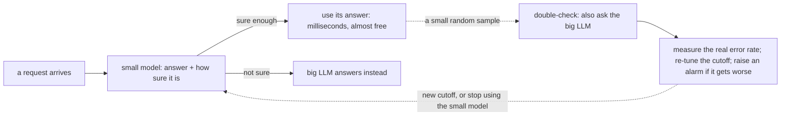

# Cascade

**Use a cheap, fast model for the easy requests and a powerful AI model (an LLM) only for the hard ones, and know, with statistics, how often the cheap model gets it wrong.**

   

**In one minute:** many apps send every request to an LLM (a ChatGPT-style model) even when most requests are simple. That is slow, costs money on every call, and makes you depend on someone else's service. Cascade sits in front of the LLM, answers the simple requests itself with a small model, and passes the rest on. The hard part, and the part Cascade is built around, is deciding **when the small model is trustworthy enough**, and proving it.

---

## The situation

Picture the support chat of a food-delivery app. Customers write things like *"my order is late"*, *"I want a refund"* or *"change my address"*. The app has to sort each message into a category (such as `late_order`, `refund`, `change_address`; AI people call these categories "intents") so it can send the message to the right team or trigger the right automation.

The quickest way to build this is to ask an LLM: *"Here is a customer message. Which of these categories fits it best?"* It works well and takes a day to set up. A few months later it is handling thousands of messages a day and three things hurt:

- **Cost grows with every message.** Each one is a paid call to the LLM.
- **You depend on someone else's service** for speed and uptime: slow replies, rate limits, outages.
- **Most of that spend is wasted.** "Where is my refund?" is easy. You are paying the same price to answer it for the thousandth time as you paid the first.

## The idea

Messages repeat, so a small, cheap model can learn the easy cases by watching the LLM:

1. The big LLM answers a few thousand real messages. We call it the **teacher**.
2. A small, fast model learns from those answers. We call it the **student**. It runs on an ordinary CPU, in milliseconds, and costs almost nothing per call.
3. Each time a message arrives, the student gives its answer **and how sure it is** (its *confidence*). If it is sure enough, its answer is used. If not, the message goes to the teacher as before.

That saves most of the cost and delay, as long as the student is right when it says it is sure.

## The catch: "sure enough" is a judgement call

Someone has to pick the **cutoff**: the confidence level above which the student's answer is trusted. The natural way is to look at a sample of the student's answers and pick the cutoff that looks best on that sample. The trouble is that a cutoff chosen this way flatters itself: the sample that picked it is also the sample that "proves" it works. In our experiments on real datasets, a cutoff chosen this way **missed its own error target in roughly 40-60% of runs**, meaning the student made more mistakes than promised.

## What Cascade does

Cascade picks the cutoff using statistics, so that you get a real promise, for example: *"the student is wrong on at most 5% of the answers it handles, with 90% confidence"*. If the evidence is too thin to support a promise, Cascade **refuses to use the student** and everything keeps going to the LLM. Then it keeps checking after launch.



In short:
1. **Learn:** train the small model on the LLM's answers (a CPU is enough; no GPU needed).
2. **Certify:** pick the cutoff with a statistical guarantee, or decline to use the small model at all.
3. **Run and watch:** serve requests, double-check a small random share against the LLM, and re-tune or raise an alarm if the small model starts getting worse (for example because customers start asking new kinds of questions).

### Words used in this README

| Word | Meaning |
|---|---|
| **LLM** | A large AI model such as ChatGPT or Claude. Accurate, slow, and paid per call. |
| **Teacher** | The LLM, in its role as the one whose answers we want to match. |
| **Student** | The small, cheap model that learns from the teacher. |
| **Confidence** | How sure the student is about its own answer, from 0 to 1. |
| **Cutoff** | The confidence level above which the student's answer is used. |
| **Coverage** | The share of requests the student answers itself (the "cheap share"). |
| **Audit** | Randomly sending some already-answered requests to the teacher too, to measure the student's real error rate. |
| **Drift** | The real-world requests slowly changing, so the student gets worse over time. |

## Try it in 2 minutes (no API key, no dataset downloads)

This example simulates a small model whose mistakes we know exactly, and compares the two ways of picking the cutoff, many times over.

```bash
git clone https://github.com/pandey0/cascade && cd cascade
python3 -m venv .venv && . .venv/bin/activate
pip install -e .
python examples/quickstart.py
```

You will see:

```text
ONE AUDIT
  naive    : cutoff 0.60, 50% answered cheaply, real error rate 5.0%
  certified: cutoff 0.62, 47% answered cheaply, real error rate 4.7%

300 REPEATED AUDITS (target: error rate <= 5%)
  naive    : deployed 100% of the time, missed the target in 39% of those, 49% answered cheaply
  certified: deployed 86% of the time, missed the target in 0% of those, 27% answered cheaply
```

How to read it: *naive* is "pick the cutoff that looks best on the sample"; *certified* is Cascade's method. "Answered cheaply" is coverage; "real error rate" is how often the small model was actually wrong on what it answered. One audit can look fine either way. Repeat the audit 300 times and the difference shows: the naive cutoff misses the 5% target in about **4 runs out of 10**; the certified one essentially never does, at the price of answering **fewer requests cheaply** (27% vs 49% here) and sometimes declining to deploy. That trade, safety for savings, is the whole idea, and Cascade makes it explicit instead of hiding it.

## Run the service locally

Cascade also ships as a small web service (`POST /v1/decide`) with API keys, rate limiting, metrics and an audit log. The demo below uses a real small model and a **simulated** LLM, so it costs nothing:

```bash
pip install -e ".[gateway,bench]"            # bench pulls PyTorch + sentence-transformers (large; use the CPU wheel)
python scripts/exp1a_prepare.py banking77 0  # downloads a public customer-message dataset and prepares it (CPU, minutes)
./scripts/demo.sh                            # starts the service, sends real messages, prints a transcript
```

Output and a 41-second replay video: [docs/demo.md](docs/demo.md). The running service serves its API docs at `/docs`; a static copy is [docs/openapi.json](docs/openapi.json).

**Using it on your own data today** means five steps. Steps 2 and 3 are scripts you adapt, not yet a one-command tool:

1. Define your list of categories.
2. Label a few thousand real inputs with your LLM (`scripts/label_with_teacher.py`: dry run by default, hard spend cap, results cached; supports Claude and Gemini).
3. Train the small model and certify the cutoff on held-out, audited data (`scripts/build_demo_artifact.py` is a complete worked example).
4. Serve the saved result: `uvicorn --factory cascade.artifact:create_app_from_env` (configured by environment variables; see [docs/runbook.md](docs/runbook.md)).
5. Watch `/metrics` and the dashboard; the runbook says what to do when the alarm fires or the cutoff is withdrawn.

## What you get

| | |
|---|---|
| **Certified cutoff selection** | Exact statistical bounds (Clopper-Pearson, with Bonferroni or Holm correction) plus six other methods to compare against, including the naive one. |
| **Web service** | FastAPI: API-key auth with scopes, rate limiting and brute-force lockout, idempotency keys, backpressure, structured logs, Prometheus metrics, OpenAPI. |
| **Audit and drift handling** | Random double-checks, rolling re-certification, a drift alarm that stays valid under continuous monitoring, and a choice of fail-open or fail-closed when the LLM is down. |
| **LLM adapters** | Claude and Gemini, constrained to answer only with labels from your list, with token and cost accounting. |
| **Operations** | Docker image, Helm chart (tested on a real cluster), Terraform for AWS (validated, never applied), Grafana dashboard, alert rules, runbook, SLOs. |
| **Reproducible research** | Every number in the docs comes from a script in `scripts/`, with run records in `evidence/`. |

## Results at a glance

All on two public datasets of customer-support messages (Banking77: 77 banking categories; CLINC150: 150 categories), with a simple student (text embeddings plus logistic regression). Details and caveats are in [docs/notes/](docs/notes/).

| | |
|---|---|
|  **Naive cutoffs miss their target about half the time** when the target is near what the student can achieve; certified cutoffs keep misses far below the allowed 10%, giving up about 4-12 points of coverage. |  **The LLM itself is wrong sometimes:** on Banking77, Claude Haiku 5.5 disagreed with the dataset's labels about 1 time in 4. A student that copies it inherits those mistakes, so "agrees with the LLM" is not the same as "correct". |
|  **When requests change over time**, re-checking against audited samples helps for mild changes and is not enough for severe ones (categories the student never saw). |  **The Grafana dashboard** on a live service: the cutoff is re-tuned from the audits while the cheap share dips and recovers. |

Also measured: the cheap path keeps working when the LLM fails or times out ([docs/reliability.md](docs/reliability.md)); a rolling restart on Kubernetes served 553 of 553 requests ([infra/README.md](infra/README.md)); batching the encoder raised throughput in most paired local runs ([docs/perf.md](docs/perf.md), noisy shared machine).

## Is this for you?

**Good fit:** your app picks from a fixed list of choices (classify, tag, route, choose a tool); volume is high and repetitive; you would accept the LLM's answers as the reference; and the bill, delay or rate limits now matter.

**Not a good fit:**

| Situation | Better choice |
|---|---|
| A few hundred requests a day, or a small bill | Just call the LLM. This is not worth the complexity. |
| You already have thousands of human-labelled examples | Train a classifier on them directly: usually more accurate, with no LLM cost. |
| Free text, reasoning, summaries | Keep the LLM. A small model on text embeddings will not work. |
| Categories change every week | Expect frequent re-training and refusals; consider retrieval instead of a fixed list. |
| High-stakes decisions (credit, hiring, safety) | Keep a human in the loop. A statistical bound on agreement is not enough justification. |
| You want something working this week | Try [TRACER](https://github.com/adrida/tracer), an open-source project built on the same core idea. |

## Honest limits

- **Alpha software (v0.1.0).** Not deployed anywhere; the AWS setup has never been applied; the repo is private for now.
- **The promise is about agreement with the LLM, not about being correct.** If the LLM is wrong 1 time in 4, a student that copies it inherits that. Our experiments show this clearly ([docs/notes/exp1b-findings.md](docs/notes/exp1b-findings.md)).
- **It assumes the audited sample looks like today's requests.** When requests change, that breaks; the audits and the alarm exist to catch it, but recovery takes time (about `audited labels / audit rate` requests).
- **Small-scale evidence:** two public datasets, one simple student, one LLM, a few data splits; the demo and load tests use a simulated LLM on a shared desktop.

## Documentation

| Read | For |
|---|---|
| [docs/story.md](docs/story.md) | A longer worked example and the reasoning behind this README |
| [docs/architecture.md](docs/architecture.md) | How the pieces fit together |
| [docs/runbook.md](docs/runbook.md), [docs/slo.md](docs/slo.md), [docs/reliability.md](docs/reliability.md) | Operating it |
| [docs/security.md](docs/security.md) | Threat model and an OWASP-based self-check |
| [docs/notes/](docs/notes/) | Experiment findings and the literature check |
| [docs/evidence.md](docs/evidence.md) | Figures, screenshots, demo video, logs |
| [SCORECARD.md](SCORECARD.md) | Production-readiness checklist, with evidence and gaps |
| [paper/](paper/) | Unpublished draft and the claim-to-evidence map |

## Where the ideas come from

Cascade builds on existing research and does not claim to have invented it. Letting a model say "I'm not sure" and choosing the cutoff with a statistical guarantee is called *selective classification*, with the threshold method going back to [Geifman and El-Yaniv (2017)](https://arxiv.org/abs/1705.08500) and a general framework in [Learn then Test](https://arxiv.org/abs/2110.01052). Using a small model trained on an LLM's own answers to take over its easy requests, with a quality check before it goes live, is the idea behind a recent open-source project and paper, [TRACER](https://arxiv.org/abs/2604.14531). What Cascade adds is a side-by-side comparison of ways to choose the cutoff, a study of what goes wrong when the LLM itself is imperfect or when requests change over time, and a tested web service around them. Full details: [docs/notes/literature-check.md](docs/notes/literature-check.md) and [docs/REFERENCES.md](docs/REFERENCES.md).

## Contributing and license

See [CONTRIBUTING.md](CONTRIBUTING.md) (`make check` runs lint, strict type checks and tests). Changelog: [CHANGELOG.md](CHANGELOG.md). Licensed under the [MIT License](LICENSE).
