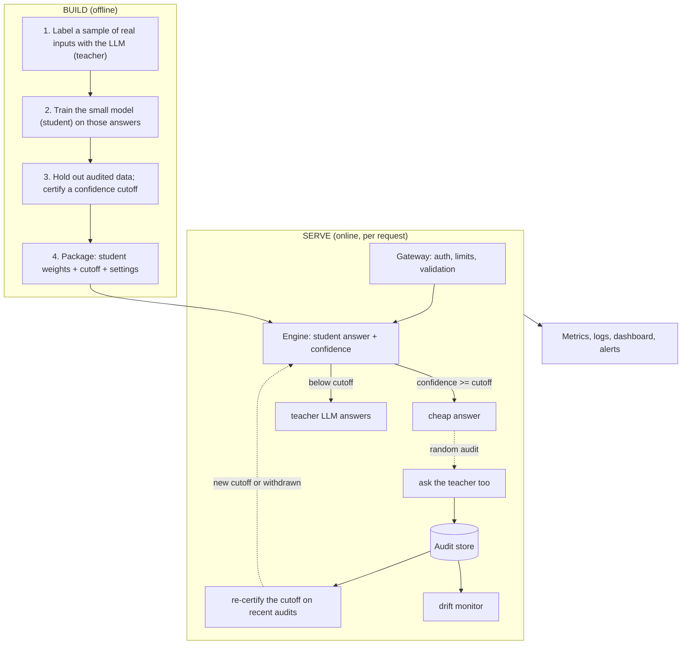
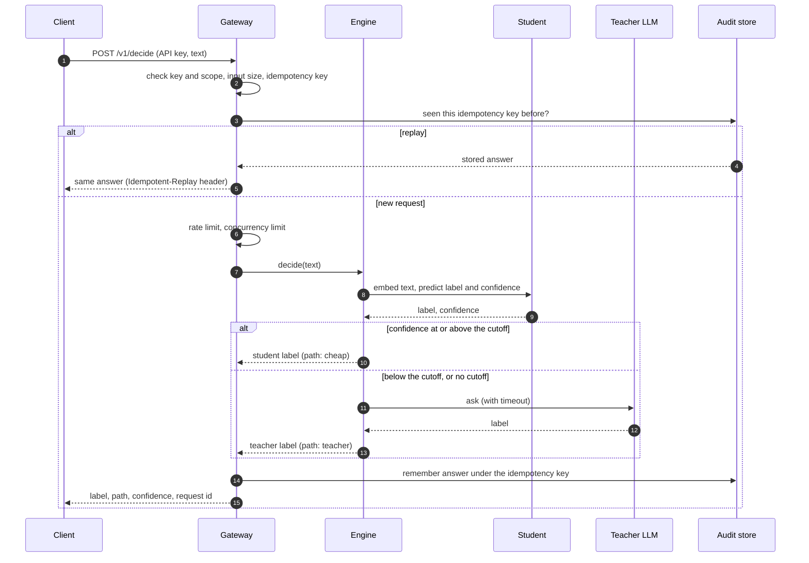
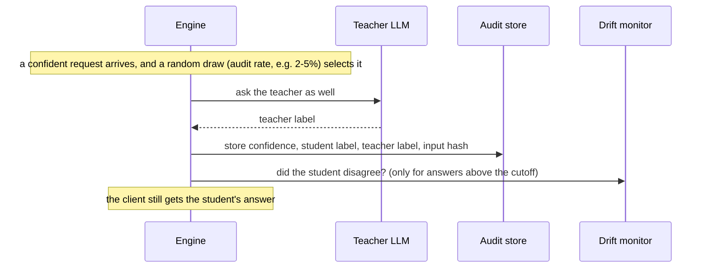
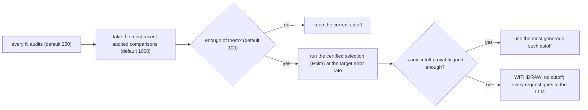
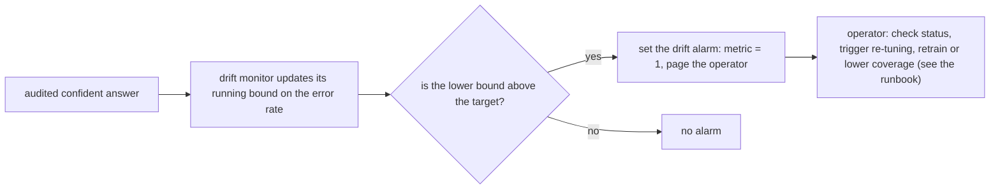
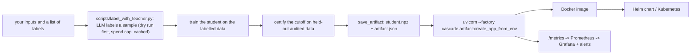

# Architecture

How Cascade is put together, what happens to a request, and what happens in the background. Terms (student, teacher, cutoff, audit, coverage) are defined in the [README glossary](../README.md#words-used-in-this-readme). For honest weaknesses of this design, see [critique.md](critique.md).

## 1. The big picture

Two phases: **build** (offline, once, and again when you retrain) and **serve** (online, per request). The service only reads what the build phase produced, plus the audit data it collects itself.

**In words.** Offline, you use the LLM to label some real inputs, train the small model on those answers, and use a held-out, audited slice to choose a confidence cutoff that you can back with a statistical bound. Online, every request goes through the gateway (security and limits), then the engine asks the small model for an answer and a confidence. Above the cutoff the small model's answer is returned straight away. Below it the LLM answers, as it did before Cascade. A small random share of the confident answers is also sent to the LLM; the comparison is stored, and those stored comparisons are what keep the cutoff honest and feed the drift monitor.

## 2. Components

| Component | What it does | Code |
|---|---|---|
| **Gateway** | HTTP surface: API-key auth with scopes, failed-login lockout, request validation, rate limit, idempotency, concurrency limit, request IDs, security headers, metrics endpoint | `src/cascade/gateway/app.py` |
| **Engine** | The per-request decision: run the student, compare to the cutoff, call the LLM when needed, apply the failure policy, record audits, trigger re-certification | `src/cascade/engine.py` |
| **Student** | Small model: text embedding + logistic regression, returns a label and a confidence | `src/cascade/students.py` |
| **Gates** | The statistics: choose a cutoff from audited data (naive and certified methods) | `src/cascade/gates.py`, `bounds.py` |
| **Teacher adapters** | Call the LLM (Claude or Gemini), force an answer from your label list, count tokens and cost, retry transient errors | `src/cascade/adapters/` |
| **Audit store** | SQLite: audited comparisons (confidence, student label, teacher label, input hash, never the text), idempotency keys, schema migrations, backup | `src/cascade/store.py` |
| **Drift monitor** | Statistical alarm on the error rate of audited confident answers | `src/cascade/drift.py` |
| **Artifact** | The package built offline: `student.npz` + `artifact.json` (cutoff, labels, settings); loaded by the service at start-up | `src/cascade/artifact.py` |
| **Batching** | Optional: groups concurrent embedding calls | `src/cascade/batching.py` |
| **Operations** | Prometheus metrics and alert rules, Grafana dashboard, Docker image, Helm chart, Terraform | `ops/`, `infra/`, `Dockerfile` |

## 3. Flow A: one request, step by step

What the `path` field means: `cheap` (student answered), `teacher` (LLM answered), `shadow` (shadow mode: LLM answered and the student was only recorded), `cheap_degraded` (the LLM was needed but unavailable, so the student's best guess was returned; only if fail-open is on).

Order of checks inside the handler: scope, input size, idempotency-key format, unknown decision (404), idempotent replay, rate limit (429), concurrency limit (503), then the engine. A teacher failure with fail-closed becomes a 503.

## 4. Flow B: the audit (how the service measures itself)

The goal is an honest, *unbiased* measurement of how often the student is wrong on the requests it answers.

Two design rules matter:

- **Only random audits (or every request in shadow mode) are stored for calibration.** Requests the LLM answered because the student was unsure are *not* stored for that purpose: they were selected for being hard, and mixing them in would make the student look worse than it is at the cutoffs that matter.
- **The audit happens in the background.** A confident request that is picked for audit is answered at once; the teacher call and the database write run on background workers behind a bounded queue (default 256). If the queue is full the audit is dropped and counted (`cascade_audits_dropped`); the drop depends on load, not on the request's content, so the audited sample stays uniform. (Before 2026-11-02 the audit ran inside the request and added the LLM's latency to 5% of requests; see [critique.md](critique.md).)

## 5. Flow C: re-tuning the cutoff (and refusing to answer cheaply)

Withdrawing is the safe failure: accuracy is preserved and cost goes back to the pre-Cascade level. The dashboard shows the cutoff as `-1` when this happens, and an alert fires if it lasts. The re-tuning runs on a background audit worker, not inside a request.

## 6. Flow D: noticing that things got worse

The alarm **informs**; it does not change behaviour by itself. The automatic protection is the periodic re-tuning above (Flow C). The monitor keeps statistics since the service started and is not reset when the cutoff changes (a known limitation).

## 7. Flow E: what happens when something fails

| Situation | What the service does | Client sees |
|---|---|---|
| LLM fails or times out, request was confident | Skips the audit, returns the student's answer | Normal `cheap` answer |
| LLM fails, request needed it, **fail-open on** (default) | Returns the student's best guess | `cheap_degraded` |
| LLM fails, request needed it, **fail-closed** | Refuses | HTTP 503 with `Retry-After` |
| No certifiable cutoff | Sends everything to the LLM | `teacher` answers, higher cost |
| Too many requests from one key | Rejects | HTTP 429 |
| Too many in flight | Sheds load | HTTP 503 with `Retry-After` |
| Wrong or missing key; too many failed attempts | Rejects; locks that address out for a while | 401, then 429 |
| Same idempotency key sent twice | Returns the stored answer, no second LLM call | `Idempotent-Replay: true` |
| The audit database cannot be written | The request is unaffected; the audit is lost, counted (`audit_errors`) and logged | Normal answer (fixed 2026-11-02; it used to return 500 on audited requests) |
| The audit queue is full | The new audit is dropped and counted | Normal answer; alert `CascadeAuditsDropping` if it persists |
| Every request-path LLM slot is stuck | Fails fast instead of queueing behind stalled calls | `cheap_degraded` (fail-open) or 503 (fail-closed) |

## 8. Flow F: from your data to a running service

Today the middle steps (train and certify) are the worked example `scripts/build_demo_artifact.py` that you adapt; they are not yet one command. The service itself, the image, the chart and the monitoring are the product-shaped part.

## 9. What is stored, and where

| Data | Where | Notes |
|---|---|---|
| Audited comparisons (confidence, both labels, hash of the input) | SQLite audit store | **Never the input text.** One database per replica today. |
| Idempotency keys and stored answers | Same database | Keyed by decision and key. |
| Student weights, cutoff, labels, settings | Artifact directory (mounted read-only) | Plain arrays and JSON; loaded without pickle. |
| Cutoff, drift state, spend counters, rate-limit buckets | Process memory | Lost on restart; per replica. |
| LLM answers used for training | A local cache (`data/cache/teacher/`), only in the offline build step | Hard spend cap; API keys come from the environment and are never written. |

## 10. Rules the design relies on

1. Only uniform random audits feed calibration (Flow B).
2. When nothing can be certified, the service stops answering cheaply (Flow C).
3. No raw input text is stored.
4. API keys come only from the environment and are never logged or cached.
5. Every number in the documentation comes from a script that writes a run record (`evidence/`).

## 11. Known gaps in this architecture

Per-replica state, a drift monitor that is never reset, and no retraining loop (the in-request audits, the exhaustible LLM-call pool and the unhandled audit-store failure were fixed on 2026-11-02). They are described, with measurements where they exist, in [critique.md](critique.md).
