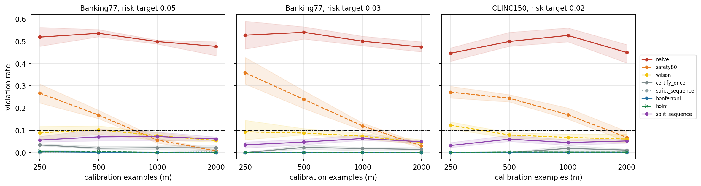
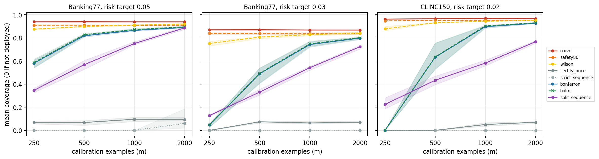
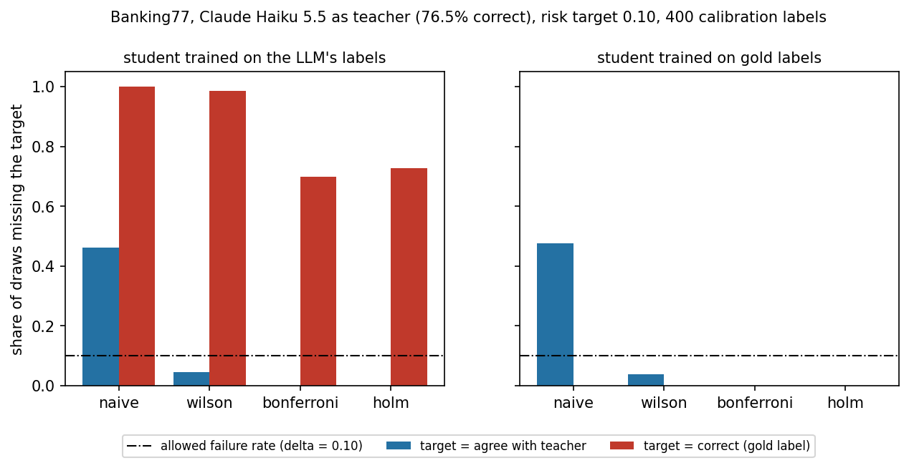
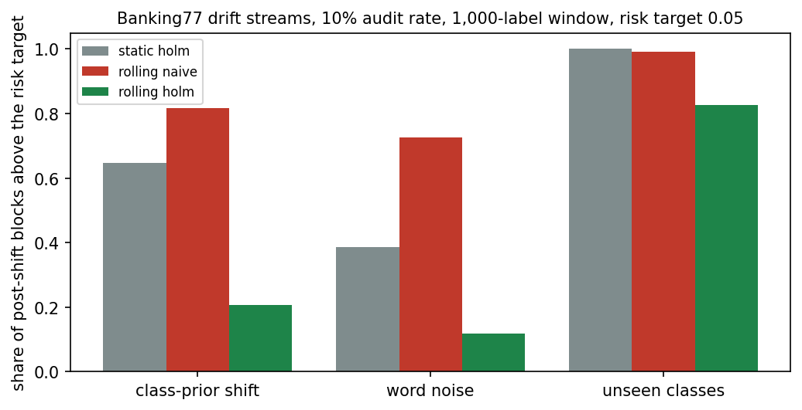
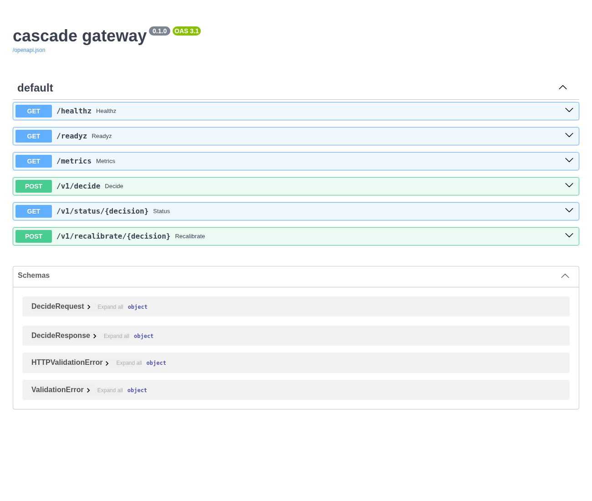
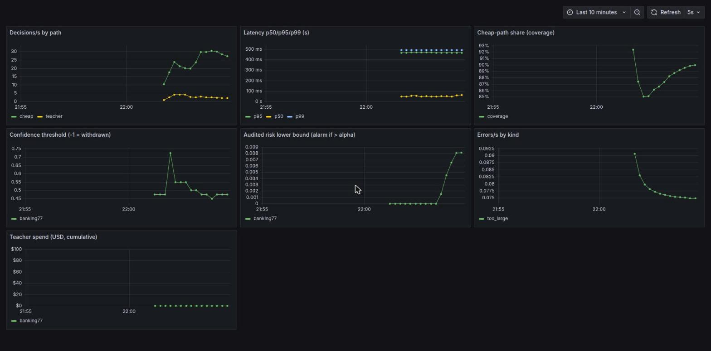
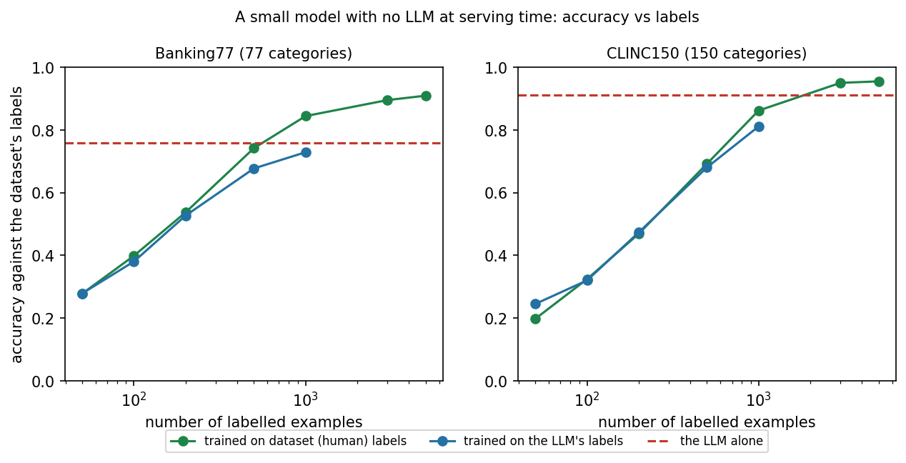
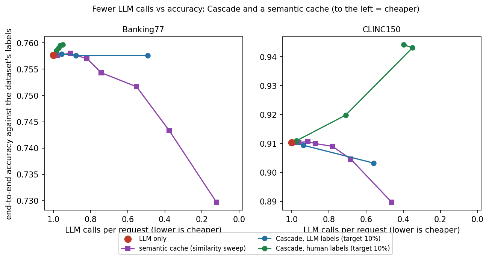

# Evidence gallery
Generated from the result files (`scripts/make_figures.py`, `scripts/make_figures2.py`); numbers are not hand-typed.

| | |
|---|---|
|  **Naive selection misses its target about half the time; certified selection does not** (Banking77/CLINC150, gold teacher) |  **Cost of validity** in coverage |
|  **With a real LLM teacher**, agreement is not correctness (Claude Haiku 5.5, Banking77) |  **Under drift**, rolling Holm recalibration helps unless the shift is severe |

The gateway's API as served (FastAPI/Swagger, `GET /docs`): 

The Grafana dashboard (`ops/grafana/cascade-dashboard.json`) with live data from a running gateway (simulated teacher, a load run with a 30% audit rate, captured in Chrome). The confidence-threshold panel shows the cutoff rising and then settling again as the gate was re-certified on audited samples, and the cheap-path share dips and recovers alongside it: 

**Demo video:** [`img/demo_replay.mp4`](img/demo_replay.mp4), a 41-second typed replay of the real captured transcript of `scripts/demo.sh` with captions (not a live screen recording, not narrated; regenerate with `scripts/make_demo_video.py`).

Other evidence in the repo: terminal transcript of the end-to-end demo (`evidence/logs/demo_transcript.txt`, `demo.md`), failure-injection results (`results/chaos.md`), Kubernetes smoke-test logs (`evidence/logs/k8s_smoke_*.txt`), Grafana panel-query check (`evidence/logs/grafana_check.txt`), CI runs (GitHub Actions, private repo), run manifests and ledger (`evidence/`). **Not yet in the repo:** a narrated screen recording of 2-3 minutes.

 
*Experiment 3: small model accuracy vs number of labels (left); fewer LLM calls vs accuracy for Cascade and a semantic cache (right; zoomed axis).*
